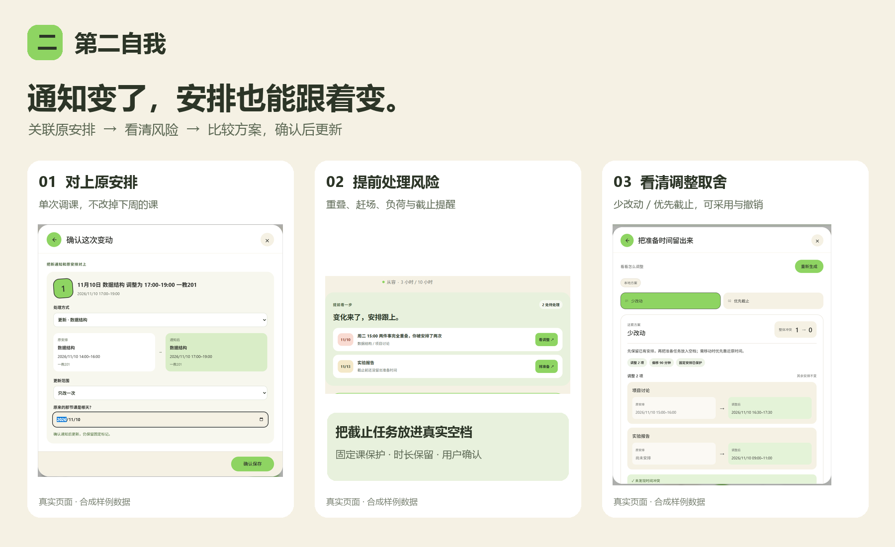
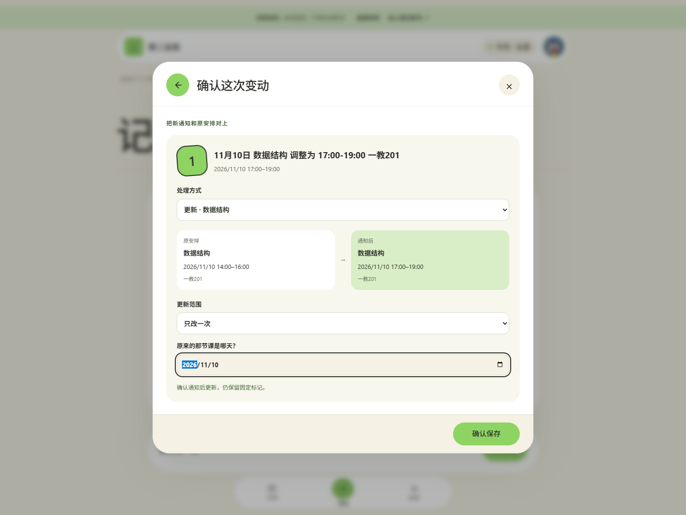
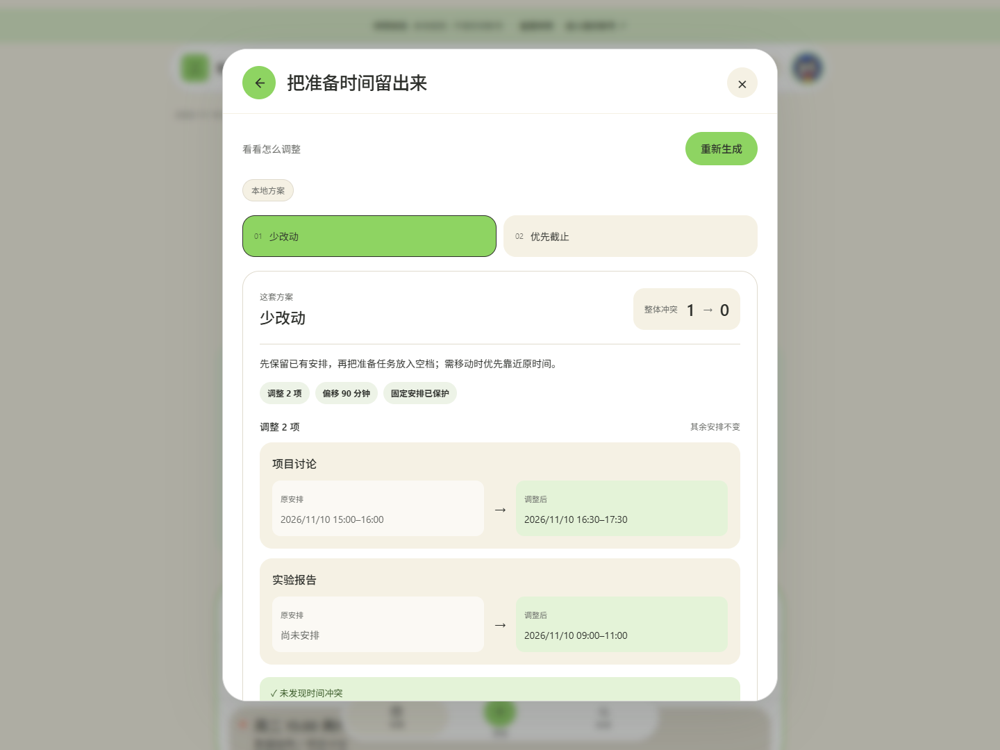

# 第二自我

把通知、课表截图和随手记录整理成安排；通知有变化时，对上原日程、发现影响，再比较怎样调整。



## 先看两件实际的事

**临时调课。** “数据结构改到周二 17:00–19:00”：解析后关联已有课程，核对原日期，选择只改一次或整组更新。只改一次会保留下周原课；截图中没有出现的课程不会被删除。

**周五交报告，预计两小时。** 截止是交付时刻，准备需要另一段时间。系统确认工作量后，在七天范围内寻找截止前空档，并避开固定课程和赶场缓冲。未知时长先问，也可以选择只提醒。

首页与“未来”先列出要处理的安排。方案始终显示理由、调整前后、变动条数、时间偏移和固定安排保护；确认才写回，可以整套撤销。日程已变时，旧方案必须重新生成。

<details><summary>查看单次调课与方案完整页面</summary>





</details>

## 10 分钟复现

环境：Node.js 22.13–24.x（推荐 `.nvmrc` 的 24.14.0）、npm、中国时区。Node 内置 SQLite，无需单独安装数据库；首次安装依赖需要网络。

```sh
git clone https://github.com/kkse7en/second-self.git
cd second-self
npm ci
npm run dev
```

打开 http://localhost:3000 。端口占用时运行 `npm run dev -- --port 3022`。生产模式：`npm run build` 后运行 `npm run start`。

1. 在登录页点击“先试试完整样例”，免注册体验冲突、截止准备、调课与撤销。样例固定在 2026-11-10，明确使用本地规则，不写个人账号，刷新或重置可恢复。
2. 正式使用请注册账号。文字、截图 → 补充信息 → 核对 → 选择新增、关联更新或忽略 → 确认保存。
3. 从首页风险入口生成方案，比较取舍后采用；需要时补充自然语言要求再生成。

## AI 与规则各做什么

| 环节 | 职责 |
|---|---|
| 模型 | 理解通知/截图，提出结构化草稿与调整候选；理解用户补充 |
| 本地规则 | 原文覆盖、字段合法性、关联建议、周期例外、冲突检测及采纳护栏 |
| 用户 | 核对识别、确认关联对象与更新范围，选择最终方案 |

复制 `.env.example` 为 `.env.local`，仅在服务端填入 `LLM_BASE_URL`、`LLM_API_KEY`、`LLM_MODEL` 后重启。图片须使用支持图像输入的模型。详见 [AI 配置](docs/AI-SETUP.md)。密钥与数据库不随提交包分发。

未配置 AI 时，文字与重排使用本地规则并标明来源；图片识别、自然语言补充不会假装成功。本地“少改动 / 优先截止”采用不同任务排序与选位策略；相同排布去重，不保证总能生成两套，也不保证全局最优。

## 使用边界

- 固定、周期、已完成安排不可被自动重排移动；用户确认的通知更新另走受控流程。
- 本地排程面向最多 300 条输入、30 个待排任务、未来七天，15 分钟网格、07:00–23:00，不拆分长任务。无可行时段时明确失败。
- 检查重叠、赶场缓冲、每日负荷与截止提醒；不掌握实时路况，也不代替用户确认地点和通知。
- 账号保存日程、完成状态、撤销与个人设置；不同账号隔离。SQLite 单实例持久盘，同一部署支持跨设备恢复；localhost 仅是本机服务。
- 断网修改留在本机，多处修改冲突需选择版本。暂无密码找回、邮箱验证或系统推送。
- 六款随机逐笔动画每轮约 1.3 秒，至少完整绘制一轮；请求较慢时继续循环，后台保存不阻断操作。

## 验证与开发证据

```sh
npm run verify
npm run build
```

[验证报告](docs/TEST-REPORT.md)记录本次范围与结果；[架构](docs/ARCHITECTURE.md)说明数据流和护栏。[三条真实 AI 交互链](docs/prompts/README.md)保留用户提问、纠错、AI 回复、源时间与相关提交；历史证据不随界面更新而改写。

截图使用实际应用及合成样例数据。本次确定性测试和浏览器检查不代表真实用户效果或模型通用识别准确率。[既有真实模型小样本](docs/verification/live-ai/README.md)保留失败与修复记录。

## 许可

项目代码 MIT；第三方动画、画笔与头像另见 [来源及许可](THIRD-PARTY-NOTICES.md)，不计为自研算法。
